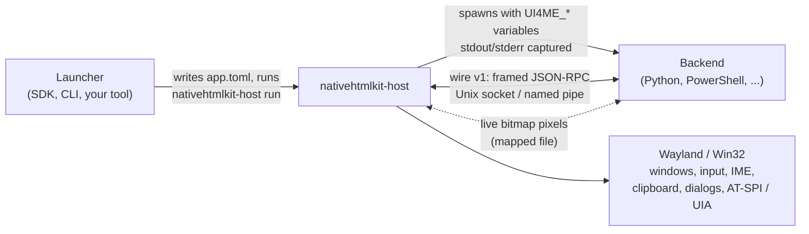
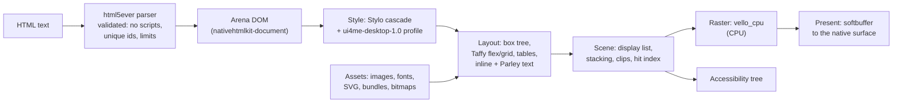

# Core architecture

This page explains how the NativeHTMLKit native host is put together: the processes, the threads,
the rendering pipeline, the security boundaries, the accessibility bridge and the bitmap channel.
It is background for SDK authors, contributors and anyone diagnosing behaviour. The wire contract
itself is specified in [`protocol/README.md`](../protocol/README.md).

## Processes

- The **launcher** is whatever the user ran (`python app.py`, the CLI). It writes a manifest, starts
  the host, relays the host's stderr and returns its exit status. The SDKs re-run the user's script
  as the backend, which is why SDK entry points tell you to keep side effects after `start()`.
- The **host** owns everything native: windows, the event loop, documents, rendering, input,
  accessibility and desktop services. One host process serves one application (with
  `instance = "single"`, a second launch only forwards `app.activate` to the first).
- The **backend** holds the application logic. It never renders and never touches native APIs; it
  sends requests and receives notifications. There is no JavaScript anywhere.

Supervision: on Linux the host re-executes itself under a transient `systemd --user` unit with
`KillMode=control-group` (except in headless or explicit diagnostic mode), gives the backend
`PR_SET_PDEATHSIG`, and runs a launcher watchdog that stops the host when its launcher disappears.
On Windows the backend runs in a kill-on-close Job Object. Launchers bind the host to themselves the
same way, so killing any process in the chain does not leave orphans.

## Threads inside the host

| Thread | Role |
|---|---|
| Owner (GUI) thread | Runs the winit event loop (or, headless, a 5 ms pump loop). Owns every window, document, layout and accessibility tree; dispatches all requests; renders and presents frames. Nothing else touches a document. |
| `nativehtmlkit-ipc-accept`, `-ipc-read-N`, `-ipc-write-N`, `-ipc-terminal` | Accept connections, decode frames and queue messages for the owner thread; write queued replies and notifications (bounded: 128 messages / 8 MiB per connection). |
| `nativehtmlkit-backend-stdout` / `-stderr` | Drain the backend's pipes into a bounded ring (512 lines) that the owner thread relays to the log, redacting the launch token. |
| `nativehtmlkit-document-read` | Reads `document.load {path}` files off the owner thread (so a stalled file system cannot freeze input); the reply follows when it finishes. |
| `nativehtmlkit-assets-N` | Decode images and fonts asynchronously; layout updates when results arrive. |
| `nativehtmlkit-dialog`, `-external-service`, `-preferences` | Native file dialogs, open/reveal, desktop preference observation (portal / registry). |
| `nativehtmlkit-launcher-watch`, `-child-reaper`, log writer | Launcher watchdog (Linux), process reaping, non-blocking lossy log sink. |

Requests are processed in arrival order on the owner thread; only asynchronous operations (dialogs,
clipboard reads, external open/reveal, path loads) answer later. That is why responses must be
correlated by id.

## Rendering pipeline

1. **Parse and validate.** `document.load` and HTML-inserting ops parse with html5ever into an arena
   DOM. The whole proposed tree is validated before it is committed (no active elements, no event
   handler attributes, unique ids, node/depth limits), so a rejected load leaves the previous
   document untouched.
2. **Style.** Servo's Stylo (vendored under `patches/stylo`) computes styles. The hosted profile
   `ui4me-desktop-1.0` fixes engine preferences and filters features before the first parse;
   dropped constructs become `UNSUPPORTED_FEATURE` diagnostics with a feature id.
3. **Layout.** Core builds a box tree and lays it out with Taffy (vendored under `patches/taffy`)
   for flex and grid plus Core code for block, inline, tables, multi-column, positioning and
   scrolling. Text is shaped and broken by Parley with fontique/skrifa fonts; Noto Sans is embedded
   as the last-resort face.
4. **Scene and raster.** A display list with stacking contexts, clips and a hit-test index is
   rasterized on the CPU by vello_cpu (`renderer: "cpu"` in results) and presented with softbuffer.
   Damage tracking repaints only what changed; animations and transitions run on the document clock.
5. **Interaction.** Native input is translated into DOM event dispatch inside the engine (focus,
   activation, editing, IME, drag, popovers, dialogs). Default actions run in the host; the events
   are then queued for the backend as `document.event`. Rules registered with `set_default_action`
   are applied during dispatch, which is the only way to cancel a default action.

Headless mode runs steps 1–3 and the interaction model (commands, events, queries), so layout
queries such as `get_rect` and `get_computed_style` are real, but no native surface is presented.
`nativehtmlkit-host render` rasterizes a file to a PNG for diagnostics.

## Documents and handles

Each window holds at most one document; a host admits at most 16 live documents. Window ids (`w1`,
…) and document ids (`d1`, …) are never reused, and every document request names both. Node
references (`node:…`) carry a generation, so a reference to a removed node fails with `-32004`
instead of silently addressing a newer node. Events of a replaced document are discarded before
delivery. This is what makes asynchronous backends safe: a late callback can never mutate the wrong
document.

## Security model

The host assumes the backend is the application's own trusted code and the **page content is not
code**:

- **No script engine.** `<script>`, frames, plugins, `on*` attributes and `srcdoc` are rejected at
  parse time; `contenteditable` is outside the hosted profile.
- **No network.** Resources load only from the document's asset root (checked after resolving
  symlinks), `data:` URLs and in-memory bundles; `http(s)` and every other scheme are refused. Links
  never navigate; they become `link_activated` events.
- **Private, authenticated transport.** The endpoint is a Unix socket in a `0700` runtime directory
  or a named pipe restricted to the logon session (remote clients rejected; the client verifies the
  pipe server runs as the same user). The first request must present the 64-hex-character
  single-use token; only one authenticated connection exists. Unauthenticated connections can only
  deliver `app.activate`.
- **Secrets stay out of logs and children.** The token is passed only in the backend's environment,
  clients remove it, the manifest may not override transport variables, and the host redacts it from
  relayed output.
- **Bounded everything.** Frame size, pending requests, outbound queues, document size, event queues,
  decoded image pixels, bitmap memory and log volume are all limited, so a misbehaving backend or
  hostile document cannot exhaust the host.
- **Injection is still your concern.** Without scripts, injected markup cannot run code, but it can
  change what users see and submit. Use text APIs for untrusted strings.

## Accessibility bridge

After every change the host derives a semantic tree from the document (roles from HTML semantics and
ARIA, names, states, relations, table structure, bounds, actions) and publishes it through AccessKit:
`accesskit_unix` (AT-SPI) on Linux, `accesskit_windows` (UI Automation) on Windows. Assistive
technology actions (focus, blur, click/default action, expand, collapse, increment, decrement,
set value) come back as input and go through the same dispatch as the keyboard and pointer. `get_accessibility_tree` returns the same
tree over the protocol, so accessibility can be tested headlessly; screen-reader journeys still need
native qualification (see the known limitation NHK-CROSS-0010 in the [README](../README.md)).

## Live bitmaps

For pixels that change often (charts, previews, video-like content), JSON would be too slow. The
backend calls `bitmap.create`; the host creates a private file of `slots × width × height × 4` bytes
(runtime directory on Linux, `%TEMP%\nativehtmlkit-bitmaps\` on Windows) and returns its path. The
backend maps it, writes straight-alpha RGBA8 into a slot and calls `bitmap.present {slot,
sequence}`; the owner thread copies that slot once (premultiplying alpha), swaps it into the
`` resource and requests a repaint without re-running style or
accessibility. Double or triple buffering lets the backend draw the next frame while the previous
one is presented. The file is unlinked after the first present, and stale transport files of dead
hosts are swept at start-up. See [`examples/wire-v1/live_bitmap.py`](../examples/wire-v1/live_bitmap.py).

## Repository layout

| Path | Contents |
|---|---|
| `crates/nativehtmlkit-host` | The binary: CLI, native windows, protocol endpoint, backend supervision, desktop services, accessibility adapter. |
| `crates/nativehtmlkit-renderer` | Document engine: style, layout, text, scene, raster, interaction, accessibility tree. |
| `crates/nativehtmlkit-document` | Arena DOM, parser sink, mutation journal, form state. |
| `crates/nativehtmlkit-assets` | Resource policy, image/SVG/font decoding, bundles, the embedded last-resort font. |
| `crates/nativehtmlkit-engine-types` | Shared identities, geometry, status and diagnostics types. |
| `patches/{stylo,taffy}`, `third_party/` | Vendored and patched upstream code with provenance; changes need upstream/provenance review, not an SDK workaround. |
| `protocol/` | The wire-v1 contract, its generator output and this documentation's protocol reference. |

Accessibility, IME, scaling and multi-monitor behaviour are operating-system integration
responsibilities and are qualified with interactive native tests, not by the headless suite.
