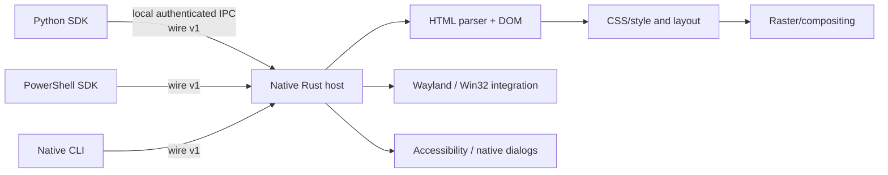

# Core architecture

The native host owns window creation, document generation, layout, hit testing and device integration. Backends communicate over local authenticated transport using the versioned public protocol. A document handle becomes stale after unload or replacement. Bitmap frames use a bounded file-mapping resource rather than new network transport.

The Core repository contains vendored and patched third-party crates; changing them requires upstream/provenance review, not an SDK-level workaround. Accessibility and multi-monitor behavior are operating-system integration responsibilities and need interactive native tests.
