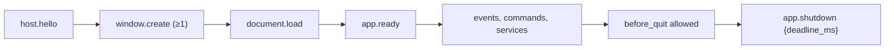

# NativeHTMLKit wire protocol v1 — reference

**Status:** public-stable since Core **1.0.3**. Changes within v1 are additive only
([`COMPATIBILITY.md`](COMPATIBILITY.md)); anything else needs protocol version 2.

This page is for **authors of SDKs and other independent clients**. Application developers should
use the [Python SDK](https://github.com/nativehtmlkit/nativehtmlkit-python), the
[PowerShell SDK](https://github.com/nativehtmlkit/nativehtmlkit-powershell) or the
[CLI](https://github.com/nativehtmlkit/nativehtmlkit-cli); UI libraries never speak the protocol.

| You want to… | Read |
|---|---|
| Learn the protocol by building a working client | [Tutorial: your first wire-v1 client](../docs/tutorials/first-wire-client.md) and [`examples/wire-v1/`](../examples/wire-v1/) |
| Implement or review an SDK | [SDK authoring guide](SDK-AUTHORING.md) |
| Look up a method, op, parameter or result member | [Generated wire tables](reference/wire-tables.md), then the schemas below |
| Understand what each document op does | [Document command reference](reference/document-commands.md) |
| Know which events arrive and what they carry | [Events guide](../docs/guides/events.md) |
| Know which HTML/CSS the host renders | [HTML and CSS support](../docs/guides/html-css-support.md) |

## Source of truth

The generated contract in [`v1/`](v1/) is authoritative; this page explains it and never overrides it.

| Artifact | What it is | Authority |
|---|---|---|
| [`v1/method-matrix.json`](v1/method-matrix.json) | Every message: direction, kind, Rust parameter type, unknown-member policy; the 81 op names | `scripts/generate-protocol-contract.py` (parameter types parsed from Rust; the method list is checked against the host's dispatch arms) |
| [`v1/schemas/methods/`](v1/schemas/methods/) | JSON Schema (2020-12) of the params of each decoding client→host method | Generated from the serde types |
| [`v1/schemas/document-command.schema.json`](v1/schemas/document-command.schema.json) | All 81 `document.command` ops (`oneOf`, tag `op`) with Rust defaults (`x-rust-defaults`) | Generated from `DocumentCommand` |
| [`v1/conformance/golden.json`](v1/conformance/golden.json) | 342 runtime cases: error code, or the JSON kind of each top-level result member, boolean values and array lengths | `crates/nativehtmlkit-host/tests/protocol_conformance.rs` against the compiled host (Linux socket and Windows pipe) |
| [`reference/wire-tables.md`](reference/wire-tables.md) | Readable tables of all of the above | `scripts/docs/generate-wire-tables.py` (generated, `--check`ed) |

`python3 scripts/generate-protocol-contract.py --check` fails when the Rust types change without
regenerating the schemas, or when dispatch arms and the method list diverge. The golden does not
compare string or number values, nested contents or notification payloads beyond member names.

## 1. Launch and transport

A launcher (an SDK, the CLI or your own tool) writes an application manifest and runs:

```text
nativehtmlkit-host run --app <app.toml> [--headless] [--allow-unsupervised]
```

`--headless` runs the whole protocol and document engine without a desktop (no native windows,
input, clipboard, dialogs, external open or accessibility; those methods return `-32001`).
The SDKs select it when `NATIVEHTMLKIT_TEST_MODE=1`. `--allow-unsupervised` is a Linux diagnostic
mode without `systemd --user` containment. Other subcommands: `render --html F --output F.png`
(diagnostic PNG, no backend), `doctor` (environment facts as JSON), `probe` (native probe window),
`--version --verbose` (embedded source identity as JSON).

### Manifest (`app.toml`)

Paths are relative to the manifest's directory; `{app_dir}` is substituted in `program`, `args`,
`cwd`, `env` values and `icon`. Unknown keys are rejected; the file is at most 256 KiB of UTF-8 TOML.

```toml
[app]
id = "org.example.Notes"        # dot-separated ASCII identity, components start with a letter, ≤128 bytes
name = "Notes"                  # ≤128 characters, used as the default window title
version = "1.2.0"               # optional
icon = "{app_dir}/icon.png"     # optional, must exist

[backend]
program = "/usr/bin/python3"    # absolute, relative to the manifest, or a bare name looked up on PATH
args = ["app.py", "--backend"]  # ≤256 arguments
cwd = "."                       # default: the manifest directory
[backend.env]                   # ≤128 entries; may not set UI4ME_*/NATIVEHTMLKIT_* transport names
PYTHONUNBUFFERED = "1"

[host]                          # all optional
startup_timeout_ms = 15000      # 1000..300000: hello + app.ready must happen within it
shutdown_timeout_ms = 5000      # 100..120000: the deadline_ms sent with app.shutdown
max_windows = 16                # 1..64
instance = "single"             # "single" (default) forwards a second launch; "multiple"
```

### Endpoint and launch variables

The host creates a private endpoint and spawns the backend (stdin closed, stdout/stderr captured)
with its own environment plus `[backend.env]` plus exactly these variables:

| Variable | Meaning |
|---|---|
| `UI4ME_ENDPOINT` | Linux: path of a Unix stream socket in a `0700` runtime directory (`$XDG_RUNTIME_DIR/nativehtmlkit-host/`). Windows: `\\.\pipe\nativehtmlkit-host-<key>`, a byte-mode pipe whose DACL grants only the current logon session, remote clients rejected |
| `UI4ME_TOKEN` | 64 hexadecimal characters, the single-use credential for `host.hello` |
| `UI4ME_APP_ID` | The manifest `app.id` |
| `UI4ME_PROTOCOL_VERSION` | `1` |

These **v1 names are permanent**. A client must read them, remove them from its own environment and
never log them or pass them to child processes (the host redacts the token from relayed output).
The backend's stdout/stderr lines are relayed to the host's stderr as JSON records with
`fields.source = "backend"` (see §10); they are never protocol traffic.

### Containment

On Linux the host re-executes itself under a transient `systemd --user` unit
(`KillMode=control-group`) unless it is headless or `--allow-unsupervised`; the backend gets
`PR_SET_PDEATHSIG`. On Windows the backend runs in a kill-on-close Job Object. A launcher that must
not be outlived by the host should bind the host to itself (Linux `PR_SET_PDEATHSIG`, Windows Job
Object with kill-on-close), as the SDKs and the CLI do. On Linux, when the launcher exits, the host
begins a normal bounded shutdown; if its event loop has not started that shutdown within
`max(shutdown_timeout_ms + 1 s, 2 s)`, a watchdog kills the backend process group and exits with
status 1. `host.capabilities.containment` describes the mode in use.

### Host exit status

`0` after a normal shutdown. `1` when the application failed (backend exited or lost its connection
while running, missed the startup deadline, exceeded the shutdown deadline) or was force-quit. A
second launch of a `single`-instance app forwards `app.activate` to the first one and exits `0`.

## 2. Framing

Each frame is a **4-byte unsigned big-endian length** followed by exactly that many bytes of one
**UTF-8 JSON object**. Length `0` and lengths above **2,097,152** bytes are fatal. A frame that is
not valid UTF-8 or JSON, or a truncated header or body, **ends the connection without a response**
(no `-32700` is ever sent); for the authenticated backend this fails the application. The host never
writes a partial frame. Results and notifications that would exceed the limit are refused:
`document.command` returns `-32002` asking for a smaller query, and an oversize `document.event`
is replaced by a `document.error`.

## 3. Envelope (JSON-RPC 2.0 subset)

Requests: `{"jsonrpc":"2.0","id":<string>,"method":<string>,"params":<object>}`. Notifications omit
`id`. Responses carry exactly one of `result` or `error {code, message, data?}`. Locked behaviour:

| Input | Outcome |
|---|---|
| `id` not a string, empty, longer than 128 bytes or containing control characters (including `id: null`) | `-32600`, response `id: null` |
| `jsonrpc` missing or not `"2.0"`; an unknown top-level member; `method` not a string, empty, longer than 128 bytes, outside `[A-Za-z0-9._-]` or starting with `rpc.` | `-32600`, `id: null` |
| `params` omitted | treated as `{}` |
| `params` an array or `null` | `-32602`, `id: null` |
| Unknown method | `-32601` with the request `id` and `data.method` |
| A batch (top-level array) or an object without `method` on the authenticated connection | treated as a response to a host request; if it is not one, logged and dropped (no reply) |
| A notification (no `id`) that fails | no response |
| Duplicate object keys | last occurrence wins |
| A request `id` reused while the first is pending | fatal: the session fails |

Send **unique string ids** and never batches. At most **128** requests may be pending. Correlate
responses **by `id` only**: a `document.load` with `path` or `asset_root` is answered when its file
read finishes on a worker thread, so later requests can be answered first. Requests with inline
`html` and all other methods are answered in order.

## 4. Authentication and handshake

The first request on a connection must be `host.hello`:

```json
{"jsonrpc":"2.0","id":"c1","method":"host.hello","params":{"token":"<UI4ME_TOKEN>","protocol_version":1}}
```

Other members (for example `client`) are ignored. Result: `{protocol_version: 1, host_version,
app_id, capabilities}` where `capabilities` equals the `host.capabilities` result (§7). Errors:
wrong `protocol_version` `-32010`; wrong or missing token `-32011`; any other method first `-32011`;
a second hello, or a hello with a valid token on a second connection, `-32005`. Only one
authenticated connection exists. Other connections may only call `app.activate` (the
secondary-instance hand-off) and get `-32011` otherwise; a malformed frame closes only that
connection.

## 5. Error codes

| Code | Name | Typical cause |
|---|---|---|
| -32600 | invalid request | envelope violation (§3) |
| -32601 | method not found | unknown method |
| -32602 | invalid params | decode failure, unknown member on a decoding method or op, semantic argument error (unknown element id, rejected markup, out-of-range value) |
| -32603 | internal | unexpected host failure |
| -32001 | unsupported | not available here: headless clipboard/dialogs/external open/attention, hidden windows on Wayland, document features outside the profile |
| -32002 | unavailable | a service or file missing at run time; a result too large for one frame |
| -32003 | denied | policy refusal |
| -32004 | closed | window, document, node or bitmap no longer exists (stale handle) |
| -32005 | busy | a limit reached (windows, documents, pending operations, HTML over 1 MiB), duplicate hello, window creation during quit preflight |
| -32006 | cancelled | request cancelled by `request.cancel` |
| -32007 | disconnected | |
| -32008 | invalid state | wrong lifecycle phase: `app.ready` without a window or twice; any call after shutdown begins except `host.capabilities`, `host.diagnostics`, `request.cancel`, `app.force_quit` |
| -32009 | timeout | |
| -32010 | version mismatch | `host.hello` `protocol_version` ≠ 1 |
| -32011 | unauthenticated | before or without a valid `host.hello` |

Errors raised by the document engine carry `data.engine_code`. Treat **every** code, including
unknown ones, as failure, and never parse `message`.

## 6. Parameters and unknown members

Every decoding method and every op with parameters rejects unknown members with `-32602`.
Locked v1 exceptions: methods that do not decode params (`host.capabilities`, `host.diagnostics`,
`app.ready`, `app.request_quit`, `app.force_quit`, `window.list`, `desktop.paths`,
`desktop.preferences`, `clipboard.read_text`) ignore them, and so do the 11 parameterless ops
(`clear_selection`, `copy_selection`, `css_profile`, `get_accessibility_tree`, `get_diagnostics`,
`get_environment`, `get_focused_element`, `get_pointer_capture`, `get_resource_stats`,
`get_selection`, `list_stylesheets`). Ops whose `element` and `node` are both optional in the schema
may still require one of them at run time (`focus`, `explain`, `get_computed_style`,
`get_control_selection`, `set_control_selection`, `replace_control_range`, `set_custom_validity`,
`get_form_data`, `reset_form`, `request_submit`, `edit_command` without a focused control).

`host.hello` validates `token` and `protocol_version` by hand. In headless mode the dialog methods
return `-32001` before decoding, so an unknown member there is also `-32001`.

## 7. Methods

Exact parameters, defaults and observed result members of every method are in the
[wire tables](reference/wire-tables.md). Summary:

### Host and application

| Method | Purpose |
|---|---|
| `host.hello` | Authenticate (§4). |
| `host.capabilities` | Capability snapshot: `platform`, `headless`, `native`, `renderer` (`"cpu"`), `css_profile`, `max_windows`, `max_documents` (16), `limits {frame_bytes, pending_requests, probe_text_bytes}`, legacy booleans (`clipboard_text`, `file_dialogs`, `external_open`, `accessibility`, `ime`, `drag_drop`, `printing`, `tray`, `window_positioning`, …) and the authoritative `features` map (below). Callable at any phase. |
| `host.diagnostics` | `{phase, windows, pending_jobs, pending_transfers, pid, backend_pid, containment, logging, dropped_notifications}`. Callable at any phase. |
| `app.ready` | The backend finished startup. Requires at least one window (`-32008` otherwise or when repeated). Must happen before `host.startup_timeout_ms`. |
| `app.request_quit` | Start the quit preflight: the host asks `app.before_quit {reason: "backend_request"}`. Returns `{requested: true}`. |
| `app.force_quit` | End the session at once without asking; the backend is killed and the host exits with status 1. |
| `request.cancel {id}` | Cancel a pending asynchronous request of this connection (dialogs, external open/reveal, clipboard read, path loads). The cancelled request is answered `-32006`; the result is `{cancelled: bool}`. |

`capabilities.features` maps a feature name to `{implemented, available, qualification, scope}`.
`available` is whether this host, OS session and mode can use it now; `qualification` is
`requires_current_native_evidence` or `out_of_scope`. Feature names in 1.0.3: `accessibility`,
`attention`, `clipboard_text`, `external_open`, `file_dialogs`, `ime`, `ime_purpose_hints`,
`incoming_drop`, `native_preferences`, `printing`, `reveal_file`, `tray`, `window_constraints`,
`window_focus`, `window_observation`, `window_position`, `window_restore`, `window_visibility`.
Probe `features.<name>.available` instead of assuming a platform, and ignore unknown keys.

### Windows

| Method | Purpose |
|---|---|
| `window.create` | Create a top-level window (`title` defaults to the app name, 900x560 CSS px, `visible`, `resizable`, `decorations`, paired `min_`/`max_` size constraints 1..8192). Returns the window description with `window_id` (`"w1"`, `"w2"`, …, never reused). `-32005` beyond `max_windows` or during quit preflight. On Linux (Wayland) `visible: false` is `-32001`. |
| `window.get` / `window.list` | Describe one / all windows: `title`, `width`, `height` (requested CSS px), `visible`, `closing`, `native`, `scale_factor`, `physical_size`, `requested {decorations, resizable, visible, size_constraints}`, `observed {…}` (native state, `null` when unknown or headless). |
| `window.set` | Change title, size, visibility, resizable, decorations, minimized/maximized/fullscreen, focus, position (`x`, `y`) and size constraints (`null` clears a constraint; update both dimensions together). What the OS honours is reported in `observed`. |
| `window.request_attention {kind?}` | Ask the window manager for attention (`-32001` headless or where unavailable). |
| `window.request_close` | Ask to close a window: after `app.ready` the host sends `window.event close_requested` and the `window.before_close` decision; see §8. |

A window is first presented when its first `document.load` succeeds, or at most 750 ms after
creation (then a placeholder page is shown). On Windows a new window is fitted into the monitor work
area; on Wayland the compositor places windows and the surface is clamped to the smallest output.

### Documents

| Method | Purpose |
|---|---|
| `document.load {window_id, html \| path, asset_root?}` | Replace the window's document. Exactly one of `html` (inline, ≤1 MiB UTF-8) or `path` (a regular file ≤1 MiB, resolved against the backend `cwd`); `asset_root` (a directory) bounds local resource loading, default: the HTML file's directory, none for inline HTML. Returns `{window_id, document_id, loaded, source, asset_root, renderer, pending_resources}`. Markup the profile rejects fails the load (`-32602`) and the previous document stays. At most 16 live documents per host. |
| `document.get {window_id}` | Describe the current document, or `{document_id: null, loaded: false}`. |
| `document.unload {window_id, document_id}` | Remove the document; the window shows nothing. |
| `document.command {window_id, document_id, command}` | Run one op on the document (§7a). |

Document ids (`"d1"`, `"d2"`, …) are never reused. Every command names both window and document, so a
command meant for a replaced document fails with `-32004` instead of touching the new one.

### 7a. `document.command` ops

81 ops in nine groups; see the [document command reference](reference/document-commands.md) for
semantics and the [wire tables](reference/wire-tables.md) for fields.

| Group | Ops |
|---|---|
| DOM content | `set_text`, `append_text`, `get_text`, `get_html`, `insert_html`, `replace_children_html`, `remove_element`, `move_element`, `trim_children`, `batch` |
| Attributes and classes | `get_attribute`, `get_attributes`, `set_attribute`, `remove_attribute`, `add_class`, `remove_class`, `has_element` |
| Query and node handles | `query`, `query_nodes`, `node_of`, `get_node`, `node_children`, `node_batch`, `element_at_point`, `text_at_point` |
| Form controls and validation | `get_value`, `set_value`, `get_checked`, `set_checked`, `get_options`, `set_selected_values`, `get_files`, `get_form_data`, `request_submit`, `reset_form`, `check_validity`, `get_validity`, `set_custom_validity` |
| Focus, selection and editing | `focus`, `blur`, `get_focused_element`, `get_control_selection`, `set_control_selection`, `replace_control_range`, `edit_command`, `select_text`, `get_selection`, `clear_selection`, `copy_selection`, `set_pointer_capture`, `get_pointer_capture` |
| Dialogs and popovers | `show_dialog`, `close_dialog`, `get_dialog`, `show_popover`, `hide_popover`, `toggle_popover`, `get_popover` |
| Scrolling and geometry | `scroll_to`, `scroll_by`, `scroll_into_view`, `get_scroll`, `set_scroll_follow`, `get_rect`, `text_rects` |
| Styles, environment and behaviour | `add_stylesheet`, `replace_stylesheet`, `remove_stylesheet`, `list_stylesheets`, `get_computed_style`, `set_environment`, `get_environment`, `set_default_action` |
| Resources and diagnostics | `register_resource_bundle`, `unregister_resource_bundle`, `get_resource_stats`, `purge_unused_resources`, `get_accessibility_tree`, `get_diagnostics`, `css_profile`, `explain` |

### Bitmaps (live pixels)

| Method | Purpose |
|---|---|
| `bitmap.create {window_id, document_id, bitmap_id, width, height, slots?, pixel_format?}` | Register a live bitmap (`bitmap_id` 1..64 of `[A-Za-z0-9_-]`, 1..4096 px per side, 2..3 slots, only `"RGBA8"`). Returns `{bitmap_id, width, height, stride, pixel_format, slots, slot_bytes, path, owner}`. |
| `bitmap.present {…, bitmap_id, slot, sequence}` | The backend finished writing `slot`; the host copies it once. `sequence` must be positive and increasing; an old one is acknowledged with `presented_to_engine: false`. |
| `bitmap.close {…, bitmap_id}` | Remove it: `{closed: bool}`. |

Map the returned `path` (a private file of `slots × slot_bytes` bytes) before the first present and
write straight-alpha sRGB RGBA8 rows of `stride` bytes into a slot. Reuse a slot only after its
`bitmap.present` was acknowledged. The host unlinks the file after the first present. Markup shows it
as `">` (`ui4me-bitmap://` also works). Limits: 8
bitmaps and 64 MiB per document, 256 MiB per host. Files live in the private runtime directory on
Linux and in `%TEMP%\nativehtmlkit-bitmaps\` on Windows; use the returned path, never a guessed one.
Worked example: [`examples/wire-v1/live_bitmap.py`](../examples/wire-v1/live_bitmap.py).

### Desktop services

| Method | Purpose |
|---|---|
| `dialog.open_files` / `dialog.save_file` / `dialog.choose_folder` | Parented native dialogs (`window_id`, `title`, `directory`, `file_name`, `filters [{name, extensions}]`, `multiple`). Answered when the user closes the dialog; cancellable. Linux needs the desktop portal. |
| `clipboard.read_text` / `clipboard.write_text {text}` | Plain-text clipboard (≤1 MiB written). `read_text` is answered asynchronously. |
| `desktop.open_external {target, window_id?}` | Open a URL or file with the default application; "accepted" is not proof that an app appeared. |
| `desktop.reveal_file {path, window_id?}` | Show an absolute local path in the file manager. |
| `desktop.paths` | Per-app `config`, `data`, `cache`, `state`, `runtime` directories. |
| `desktop.preferences` | `{available, source, color_scheme, reduced_motion, high_contrast, revision, scope}`; `null` = not observed. |
| `probe.get_text` / `probe.set_text` | Text of the built-in probe surface of a window without a document (host self-tests). |

All of these except `desktop.paths`, `desktop.preferences` and `probe.*` return `-32001` in headless
mode.

## 8. Lifecycle, host requests and notifications



Host phases (`host.diagnostics.phase`): `starting`, `connecting`, `initializing` (after hello),
`running` (after `app.ready`), `quit_pending`, `quitting`, `failed`, `stopped`.

**Host → client requests** must be answered with `{"allow": true}` or `{"allow": false}`; a missing,
false or non-boolean `allow` vetoes:

| Request | When |
|---|---|
| `window.before_close {window_id, reason}` | the user or `window.request_close` asks to close a window (preceded by `window.event close_requested`). Allowed → the window closes (`window.event closed`). |
| `app.before_quit {reason}` | `app.request_quit` (`reason: "backend_request"`) or closing the last window (`"last_window"`). Allowed → `app.shutdown`. |

Answer any other host request with an error (`-32601`). There is **no host-side deadline** for these
decisions: a backend that never answers keeps the window or app open until `app.force_quit` or the
user's Ctrl+Shift+Q in a document window.

**Notifications** (host → client): `document.event`, `document.error`, `window.event`,
`app.shutdown {deadline_ms}`, `request.cancelled {id, reason}` (a pending close decision superseded by
an app-wide quit), `app.activated` (a second launch: `{args, cwd, activation_token}`), and
`desktop.preferences_changed` (a new preferences snapshot). Payloads are described in the
[events guide](../docs/guides/events.md). Ignore unknown notifications and unknown members.

**Closing before `app.ready`:** a backend `window.request_close` of one window while another usable
window remains closes it without a decision; closing the last usable window, or any native close by
the user during startup, cancels startup (`app.shutdown`).

**No `closed` event for the last window:** when an allowed close of the last window starts shutdown,
no `window.event closed` is sent for it. `app.shutdown` means every window and document handle is
stale; later window calls fail with `-32008`. Release resources and exit before `deadline_ms`, or
the backend is killed and the host exits with status 1.

**Output backpressure:** a backend that stops reading is not disconnected because of input events.
When its outbound queue reaches three quarters of its bound (96 messages or 6 MiB), further
`window.event` and `document.event` notifications are dropped and counted in
`host.diagnostics.dropped_notifications`. Responses, host requests and all other notifications are
never dropped; a backend that leaves even those unread past the full bound fails the session. Keep
reading while you work.

## 9. Markup and resource names

`ui4me-res://`, `ui4me-bitmap://` and `data-ui4me-{drag,no-drag,resize,drop}` remain valid in v1;
`nativehtmlkit-res://`, `nativehtmlkit-bitmap://` and `data-nativehtmlkit-*` are additive aliases of
the same objects. Wire-visible identifiers keep their v1 values: CSS profile `ui4me-desktop-1.0`,
profile id `ui4me-css/1`, diagnostics schema `ui4me-diagnostics`. There is no JavaScript, no HTTP
loading and no browser engine; see [HTML and CSS support](../docs/guides/html-css-support.md).

### Known limitations of v1

- Close/quit decisions have no host-side deadline (§8).
- A Linux host whose whole process is stopped (`SIGSTOP`, a debugger) cannot bound itself; the
  watchdog thread does not run. A launcher that must survive this kills the host itself (its pid is
  in `host.diagnostics`).

## 10. Host diagnostics output (not part of the wire contract)

The host writes one JSON record per line to stderr (`{"timestamp","level","fields":{…},"target"}`).
Backend stdout/stderr lines appear as records with `fields.source = "backend"`, `fields.stream`
and `fields.text` at every level, launch token redacted. `NATIVEHTMLKIT_DIAGNOSTICS=off|normal|debug|trace`
selects the host's own detail (`off` keeps errors and backend output); at `trace` it records request
receipt and completion (method, id, duration, error code) and notification types, never params,
results or values. The sink is bounded and lossy; `host.diagnostics.logging` reports the drop
counters. Record shapes may gain members: parse them defensively.

## Compatibility and change ownership

See [`COMPATIBILITY.md`](COMPATIBILITY.md) for the v1 stability rules and
[`CONFORMANCE-ROADMAP.md`](CONFORMANCE-ROADMAP.md) for the qualification evidence. Native capabilities
vary by OS and session; Core 1.0.3 has recorded accessibility and platform qualification limits
(for example, Orca on Linux does not announce a collapsed drop-down's value change) that the stable protocol declaration does not hide.
