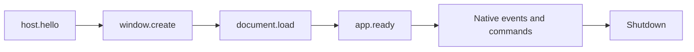

# NativeHTMLKit wire protocol v1

**Status:** public-stable contract as of Core **1.0.3**. This protocol is for SDK authors and protocol conformance testing, **not** for UI-library authors or normal application code. SDK users should use the [Python API](https://github.com/nativehtmlkit/nativehtmlkit-python) or [PowerShell API](https://github.com/nativehtmlkit/nativehtmlkit-powershell).

## Host process and transport

A launcher runs `nativehtmlkit-host run --app <app.toml>`. The host starts a private, authenticated local channel: a Unix-domain stream socket on Linux or a restricted named pipe on Windows. The backend receives `UI4ME_ENDPOINT`, `UI4ME_TOKEN`, `UI4ME_APP_ID`, and `UI4ME_PROTOCOL_VERSION` at launch. These wire-v1 environment names are fixed; do not log tokens or leak them to subprocesses. The transport is **not HTTP**, a network service, or an embedded browser.

## Frames and requests

Each message is **four bytes of unsigned big-endian length** followed by one UTF-8 JSON object, with a maximum payload of **2,097,152 bytes**. Messages use a strict JSON-RPC 2.0 subset:

```json
{"jsonrpc":"2.0","id":"request-1","method":"host.capabilities","params":{}}
```

Use unique nonempty string request IDs; no batches. Requests can complete out of order. Responses correlate by ID, not arrival order. The first request must be `host.hello` with the launch token and `protocol_version: 1`. The host can also initiate before-close decisions and asynchronous notifications. The client must keep reading the channel while processing incoming events.

## Lifecycle



Once ready, the client may issue document commands, window lifecycle operations, desktop services and diagnostics. Host→client request approvals must be answered explicitly. Native capabilities vary by OS and session. Probe negotiated capabilities rather than assuming every feature exists on all platforms.

## Generated contract and conformance

The source of truth for the **exact** request/response fields, 81 document operations, parameter schemas and error values is the generated contract under [`protocol/v1/`](v1/) and the Rust serde definitions in the Core source. The generator `scripts/generate-protocol-contract.py --check` verifies those definitions against dispatch arms; the runtime `protocol_conformance` test checks their golden behavior. Use these sources for SDK implementation; this page is an orientation, not a replacement for the generated wire contract.

## Compatibility and change ownership

Within wire v1, changes are additive only. Non-additive transport/protocol changes require a new wire major version and conformance across SDKs. Any protocol extension must start as an approved record in the central Project register; consumer libraries must never call private Rust internals.

## References

- [`protocol/COMPATIBILITY.md`](COMPATIBILITY.md) — detailed compatibility policy (restore/generate if removed by cleanup)
- [`protocol/SDK-AUTHORING.md`](SDK-AUTHORING.md) — SDK implementation details (restore/generate if removed by cleanup)
- [`docs/API.md`](../docs/API.md) — Core responsibility overview
- [`docs/BUILD.md`](../docs/BUILD.md) — build and qualification commands
- [Public developer site](https://github.com/nativehtmlkit/nativehtmlkit)

Historical source revisions and full per-method wire definitions must always be checked against the exact version being shipped. Core 1.0.3 has recorded accessibility and platform qualification limits; those are not hidden by the stable protocol declaration.
